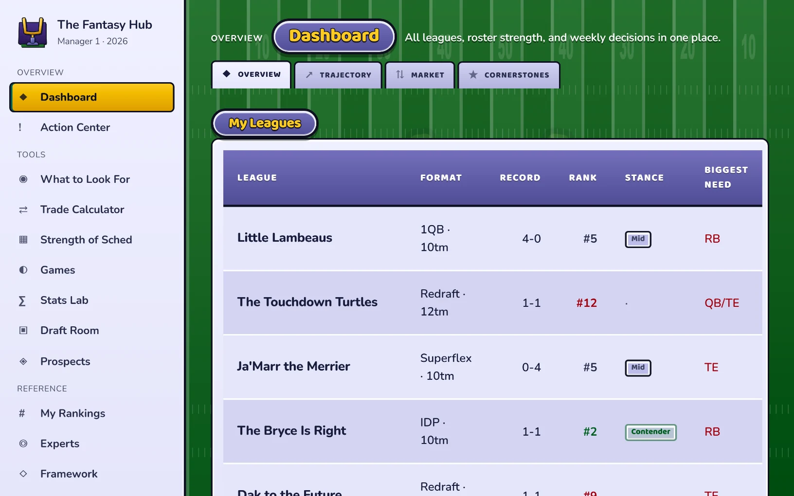
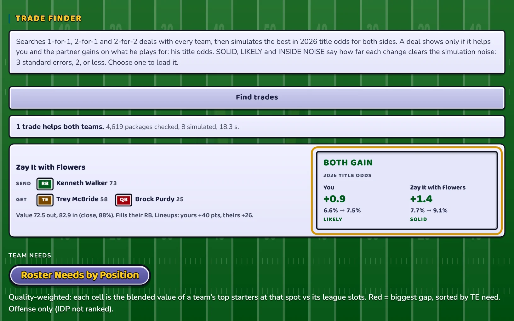

# Fantasy Football Dynasty Hub (Work in Progress)

> **Work in progress:** Current data covers three Sleeper dynasty leagues (1QB, Superflex, and IDP). A reusable demo dataset is planned.

A static vanilla JavaScript web application and Python data pipeline for dynasty fantasy football roster evaluation, multi-year aging projections, and Monte Carlo trade simulations.

## App preview



The league hub brings roster evaluation and multi-year projections into one view.



Trade Finder compares candidate deals and simulated title-odds changes for both teams.

## Local Preview

The frontend in `site/` is a static single-page application with no npm build step:

```bash
python -m http.server 8000 --directory site
```

Then open `http://localhost:8000` in a browser.

## Repository Layout

| Directory | Contents |
| --- | --- |
| [site/](site/) | Static app, generated data bundles, and JavaScript tests. |
| [projections/](projections/) | Data builders, model inputs, and evaluation scripts. |
| [historical/](historical/README.md) | Historical source datasets and reproducible feature builders. |
| [Leagues/](Leagues/) | Sleeper league snapshots and roster-cache builder. |
| [notes/](notes/README.md) | Model evidence, experiment results, and FAAB analysis inputs. |
| [docs/](docs/README.md) | Architecture, valuation methodology, and refresh instructions. |
| [cloudflare/](cloudflare/) | Optional account-profile API. |

The checked-in data supports local preview. Rebuilding every feed also needs the
optional inputs described in [the pipeline guide](docs/PIPELINE.md). Historical
data is retained because current builders read it; it is not part of the static
page download.

## Implemented vs. In-Progress Scope

- **Implemented in code:** Roster comparison tables, KeepTradeCut market value integration, multi-source ranking aggregation (with half-PPR to full-PPR conversion), five-year aging curves, and Monte Carlo championship equity simulations (`site/js/trade-sim.js`).
- **Work in progress:** Replacing hardcoded Sleeper league snapshots with a clean sample dataset for standalone public use, and modeling exact league-specific draft-lottery and Max PF draft-order rules in `originSlot` (currently approximated by starter strength).

## Data Sources and Limitations

- **External feeds:** Data generation scripts read public endpoints from the Sleeper API, KeepTradeCut, FantasyPros, and nflverse. Upstream schemas and availability can change without notice.
- **Manual inputs:** Certain analyst tier boards require local CSV inputs that are not fetched automatically by `projections/build_all.py`.

## License

[MIT](LICENSE)

## More projects

More of my work and contact details are at [twhite.dev](https://twhite.dev).
